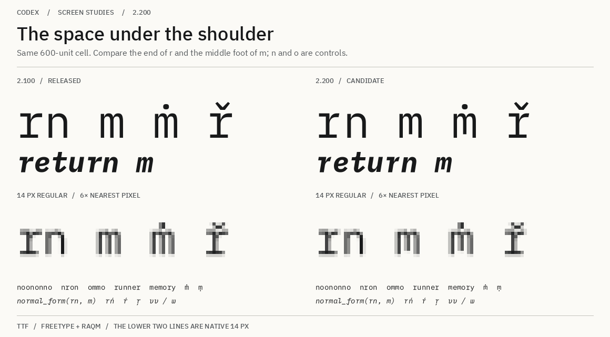

# Codex 2.200 · Medium screen cut

The comparison is to the **published Codex 2.100**, not to an unmodified
upstream typeface. There are now three real weights per family: 400, 500
and 700, each with its own italic. The terminal remains the primary brief;
Sans and Serif keep their own proportions and jobs.



## Decisions at reading size

**Weight.** [IBM and Bold Monday, *Plex Specs*](https://www.ibm.com/plex/specs/)
show Text, Medium and Semi Bold as separate designs with italic partners.
All three are present as complete TTFs in the [already pinned archives](../sources.lock.json).
2.100 jumped straight from Regular to Bold. In a 14 px grayscale proof of
`noononno Hono 120`, the five upright Mono trials (Regular / Text / Medium /
SemiBold / Bold) covered the equivalent of 316 / 356 / **401** / 456 / 511
black pixels, rounded. Text sat close to Regular; SemiBold approached emphasis.
We took Medium and its drawn italic, not a stroke expansion or an oblique.
The new 500s use the same screen-cut program as their siblings, on their own
points. Mono's Medium lining-zero mark is 228 units tall, between 236 and
218; its text zero and turned upright `l` are fitted to that weight as well.

**Mono.** [Philipp Nurullin / JetBrains, *JetBrains Mono*](https://www.jetbrains.com/lp/mono/#letter)
changes the drawing inside a fixed width; its 13 px quicksort specimen shows
the relationship in code as well as in capitals. [Microsoft Typography,
*Verdana*](https://learn.microsoft.com/en-us/typography/font-list/verdana#overview)
describes Matthew Carter and Tom Rickner's small-pixel treatment of tight
pairs, specifically `rn` turning into `m`. In 2.100, the flag of Mono
Regular `r` projected to x=559 in a 600-unit cell. The wide stretches of
white beside two cells contrasted with three equal black feet packed into
one `m`. Widening the advance, raising the family's x-height or adding code
ligatures would change a working terminal contract. Instead:

1. The first drawing pulled back the top/underside of the flag by 53/75
   units and lifted the two corners of the middle foot by 175. In enlarged
   `m` the opening was clear, but in `normal_form` the middle looked like a
   hanging tooth; the hole after repeated `r`s was too prominent.
2. The final drawing keeps more of the flag: top/underside retreat by
   32/50, 36/56 and 40/62 units in 400/500/700. The middle foot lifts by
   78/88/100, along the stem's *own* edges in each italic. At 14 px the
   Regular center pixel one row above the baseline falls from 184/255 to
   14/255 ink; the two outside feet stay put. Regular `r`'s right bearing is
   now 73 rather than 41 units. The slab foot, `n`, `o`, `v` and `w` stay
   put. Accented `ŕ ř ŗ ṁ ṃ` and the corresponding localized Cyrillic
   `т` component follow the drawings without moving their marks.

[Rainer Erich Scheichelbauer, *Spacing*](https://glyphsapp.com/learn/spacing#starting-out)
tests straight and round sides with `noononno` at the intended size. We used
those unchanged letters as controls around `r` and `m`; we did not transplant
proportional sidebearings into a monospace. [James Edmondson / OH no Type Co.,
*Proof It!*](https://ohnotype.co/blog/proof-it) compares extremes in the same
paragraph and distinguishes a diagnostic proof from a specimen. That is why
the decision above was made in shell strips, not from the enlarged alphabet.

**Sans.** A selected 14–15 px label can now use 500, distinct from 400 body
copy without borrowing the 700 heading. The 2.100 open `c/e` lips carry
through the new masters. A second proof of `façade` and `sœur` exposed a
trap: moving a tip halfway along a *longer* Bézier handle overcuts an
integrated shape. Medium Italic `ç`'s outer endpoint moved from the first
trial's (413, 61) to (428, 93), and `œ`'s inner endpoint from (713, 112)
to (729, 132). Both now retreat by the matching base lip's displacement.
The same issue was visible in released Regular `æ`: its inner tip is now
(730, 123), up from (718, 98). The cedilla, counters, advances and point
hints are untouched. In a 16 px FreeType proof, the peak difference between
the lower lips of Medium Italic `c` and `ç` fell from 77 to 12 out of 255
gray levels, sampled at the same pixel origin.

**Serif.** [Veronika Burian, José Scaglione and team / TypeTogether,
*Literata 3.0*](https://www.typetogether.com/custom-fonts/literata-3-0)
contrast the tighter, higher-contrast headline with a sturdier, looser
caption. Their sketches and paragraph work distinguish *role* from weight.
We rejected tightening Codex Serif or applying the Mono shoulder treatment
to it. The new 500 is a subhead or marginal voice next to unchanged 18 px
Regular prose. Text figures remain the default; `lnum` and fractions still
work, including in Medium Italic. This is a weight extension, not an
optical-size axis.

**Mixed-weight underlines.** Family-level proofing found a change worth
making to the decoration metrics, separately from the drawings. In 2.100
Sans the Regular underline was 60 units thick at −95 and the Bold was 100
at −66; the new master's 77 at −83 would have introduced a third step.
In Chromium at 16 px, adjacent spans with CSS `text-underline-position:
from-font` and `text-decoration-thickness: from-font` jumped one row at
the change to Medium. They now stay on the same row. Each family's
styles use *its own* Regular rail: position/thickness −140/60 for Mono,
−95/60 for Sans and −78/44 for Serif. This changes the recommended
decoration, not the baseline, leading, strikeout or underscore glyph.

## Installation contract

The four existing PostScript names per family are unchanged. New examples:
`CodexMono-Medium`, `CodexMono-MediumItalic`. The latter is a 500 at −9°,
not a slanted roman; Sans's and Serif's Medium Italics are −11° and −14°.
Following the OpenType [naming table, IDs 1/2 and 16/17](https://learn.microsoft.com/en-us/typography/opentype/spec/name#name-ids),
[OS/2 weight and selection fields](https://learn.microsoft.com/en-us/typography/opentype/spec/os2#usweightclass)
and [style attributes table](https://learn.microsoft.com/en-us/typography/opentype/spec/stat),
legacy menus get a separate “Codex Mono Medium” Regular/Italic pair; the
typographic family is “Codex Mono” with styles “Medium” and “Medium Italic”.
Private legacy families use “ Med” to fit the shorter name limit. The static
`STAT` values identify weight and italic; they do not make a variable font.
Name ID 5, unique IDs and fontRevision identify 2.200. The archive includes
only the public editions, the original notice, source pins, instructions
and a SHA-256 manifest. No inspiration font was imported or traced.

The public cmaps remain **1,049 / 895 / 930** code points per style (Mono /
Sans / Serif). The full private editions have **11,929 / 11,518 / 11,553**.
Public Mono retains 600-unit cells and its original zero-width marks. The
private patcher's established nominal all-600 convention stays intact;
HarfBuzz still gives the mark zero shaped advance in `q\u0323`. The hhea and
typo line remains 1025 / −275 / 0 on a 1000-unit em. The public Windows
clipping pairs remain 1150/350, 1150/275 and 1150/286. Neither a smaller
line box nor a global transform accounts for the visual differences.

For the **private** icon edition, the old patcher finalizer set clipping
per file: for example Mono Regular allowed 1119 units above the baseline
while Bold needed 1150. A legacy engine using those values could change row
height on a weight switch. The limits now cover the largest *actual patched
outline* in each six-face family: 1150/350, 1150/282 and 1150/286. This adds
at most 31 units above or 4 below to a returning face's clipping allowance.
It doesn't move an outline or change the recommended 1300-unit line. No
Windows layout engine was available to test the fallback behavior.

## Reproduce

```sh
mise install && mise run check
mise exec -- python tools/package_public.py
python3 -m unittest discover -s site && python3 site/build.py
cmp build/Codex-Fonts-2.200.zip build/showcase/Codex-typefaces.zip

mkdir -p build/proof-base
curl -fL https://github.com/nothumancode/codex-fonts/releases/download/v2.1.0/Codex-Fonts.zip -o build/proof-base/v210.zip
echo 'b4b709762973c97247601a2f3df3f981fece9b6c5ed6017b69fc2fbd372aebd7  build/proof-base/v210.zip' | sha256sum -c
unzip -oq build/proof-base/v210.zip -d build/proof-base
xvfb-run -a -s '-screen 0 1024x240x24 -dpi 72' python3 tools/proof_medium.py \
    build/proof-base dist/public build/medium-proofs --xterm
```

The last command needs Linux XTerm/Xft, Xvfb, Fontconfig, and Python with
Pillow/RAQM/XCB. It runs an actual grep in XTerm at 12, 14 and 16 px, with
each named style as the primary face. Fontconfig sees only one edition per
run. Each capture checks XTerm's file, pixel size and non-emboldened flag;
`xterm-files.txt` records the matches. Read the light and dark PNGs at 100%.
Only the **labeled** 6× crop in `joins.png` is pixel-enlarged. The separate
Sans interface and Serif paragraph sheets are shaped FreeType renders.
Without `--xterm`, only the three shaped sheets are generated.

These Linux proofs test drawing, fit and selection. They do not certify
CoreText, DirectWrite, mobile font installation, faster reading or lower
eye strain.
