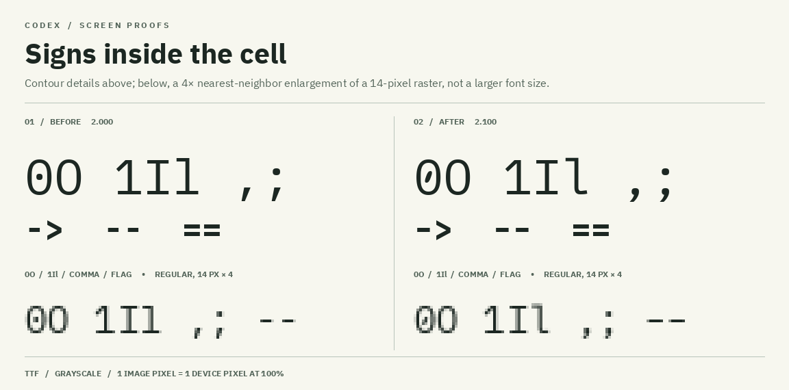

# Screen cut 2.100

The comparison is against the first Codex build (`75ba655`), not against a
different typeface. Build both revisions with the pinned archives and patcher
before comparing the same styles. There are no new weights or code ligatures.



## What moved

- **Mono.** The zero mark remains detached from its bowl. In Regular its
  bounding box changes from 124 × 118 to 144 × 236 units; the Bold mark is
  shorter to leave space inside the heavier bowl. The standard `zero`
  feature still supplies a through-slash. Upright `l` and `ł` keep their
  ascender flag but exit to the right instead of resting on a double foot;
  `ss08` gives the previous broad foot. The cursive italic exit is unchanged.
- **Terminal punctuation.** Regular's ASCII hyphen goes from 290 × 84 to
  384 × 68 units. It uses the minus stroke's vertical grid fitting but stays
  shorter than the 476-unit minus. Commas, semicolons and curly quotes use
  the source's round-headed cuts; `ss09` now gives the former blades.
  Solid upper box rails extend from y=950 to 1100 so integer-height rows
  can meet. In an XTerm 390/Xft regular-face proof, a two-pixel break in the
  vertical rail at 14 and 16 pixels closed; the 12-pixel rail stayed continuous.
  The junctions, dashed-line gaps, horizontal endpoints, block
  fills and font line metrics haven't been stretched.
- **Sans.** In Regular the inner terminal tip of `c` retreats from (417, 149)
  to (394, 100); that of `e` from (426, 147) to (415, 124). Each style follows
  its own curve rather than shearing the upright master. The same cut follows
  accented and integrated forms; letter advances and the upper bowls stay put.
- **Serif.** In running text, a 1934 date no longer makes a band of cap-height
  figures. In Regular the zero tops out at y=548 instead of 710 and the three
  descends to −166 instead of −12. These are the original designed text-figure
  outlines, not reduced lining digits. `lnum` restores the original lining
  figures; fractions, superscripts, subscripts and zero alternates still work.

All dimensions are font units on a 1,000-unit em. Source grid fitting is
retained where point topology permits. The finalizer appends smart dropout
control to the TrueType pre-program instead of replacing its CVT setup.

## What did not move

All four styles in each row have the following number of encoded Unicode
code points. The full Nerd TTF and full Nerd WOFF2 are identical in repertoire;
its web subset is intentionally smaller. The public WOFF2 is **not** a subset.

| Family / source archive | Public TTF + WOFF2 | Full Nerd, 2.000 → 2.100 | Private web, 2.000 → 2.100 |
| --- | ---: | ---: | ---: |
| Mono / IBM Plex Mono 2.5.0 | 1,049 | 11,929 → 11,929 | 866 → 866 |
| Sans / IBM Plex Sans 1.1.0 | 895 | 11,518 → 11,518 | 448 → 448 |
| Serif / IBM Plex Serif 2.0.0 | 930 | 11,553 → 11,553 | 449 → 449 |

No mapped advance changed from the preceding Nerd edition, in any style.
Every mapped Nerd Mono advance is 600; public Mono retains the text source's
600-unit cells and zero-width marks. The existing fixed-pitch metadata and
the shared ordinary-lowercase envelope are intact. Sans and Serif remain
proportional, including their true italics.

`hhea` and OS/2 typographic metrics are 1025 / −275 / 0 (ascent / descent /
line gap), unchanged from the preceding Nerd edition. Its per-style Windows
clipping metrics are also unchanged. The new public edition uses that same
1,300-unit line and enables USE_TYPO_METRICS; its clipping limits cover the
tallest and deepest outlines across each family's four styles. These limits
are not the recommended baseline distance.

## Make the comparison yourself

With the [build prerequisites](../README.md) available:

```sh
git worktree add --detach ../codex-before 75ba655
(cd ../codex-before && mise install && mise run build)
mise install && mise run check
uv run --no-project --with pillow==12.0.0 python tools/proof.py \
    ../codex-before/dist dist build/screen-proofs
```

The proof tool needs a Pillow build with RAQM (HarfBuzz shaping). It produces
five paired PNGs: Mono at 12/14/16 pixels on light and dark, a 14-pixel
nearest-neighbor detail, Sans UI and Serif prose. Open at 100% for real size.
For an integer-cell terminal check, load each release of Codex Mono Nerd Font
Mono separately in XTerm, disable forced box-character substitution and try
`printf '┌──┐\n│0O│\n└──┘\n'` at those pixel sizes. Antialiasing, hinting,
cell rounding and terminal-drawn graphics differ across platforms. These
proofs are comparisons of actual renders, not measurements of reading speed
or eye strain.
